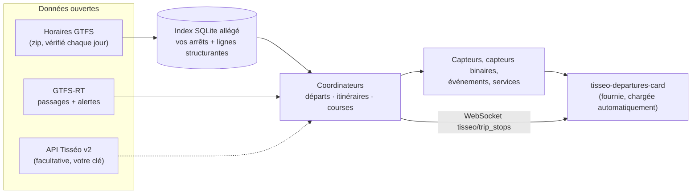

<p align="center">
  
</p>

<p align="center">
  <a href="https://hacs.xyz/docs/faq/custom_repositories/"></a>
  
  <a href="https://github.com/TurbulenceDeterministe/tisseo-ha/releases"></a>
  
  <a href="LICENSE"></a>
  <br>
  <a href="https://github.com/TurbulenceDeterministe/tisseo-ha/actions/workflows/tests.yaml"></a>
  <a href="https://github.com/TurbulenceDeterministe/tisseo-ha/actions/workflows/hassfest.yaml"></a>
  <a href="https://github.com/TurbulenceDeterministe/tisseo-ha/actions/workflows/hacs.yaml"></a>
</p>

<p align="center">
  <a href="README.md">English</a> · <b>Français</b> · <a href="https://turbulencedeterministe.github.io/tisseo-ha/">Page du projet</a> · <a href="CHANGELOG.md">Journal des versions</a>
</p>

**Tisséo pour Home Assistant** intègre le réseau toulousain (métro, tram, Linéo, bus, Téléo) à Home Assistant : prochains passages avec le temps réel quand Tisséo le publie, perturbations, itinéraires avec une ou deux correspondances, aide « partir maintenant », vélos VélôToulouse et capacité des parcs relais. Une carte de tableau de bord animée est fournie et se charge toute seule.

**Ni clé API, ni compte.** Tout repose sur des données ouvertes publiques (GTFS, GTFS-RT, GBFS). Si vous avez *votre propre* clé pour l'API officielle Tisséo, vous pouvez l'ajouter, mais elle n'est pas nécessaire.

<p align="center">
  
</p>

## Fonctionnalités

| | |
|---|---|
|  | **Départs en direct.** Les comptes à rebours avancent à la seconde. L'icône temps réel n'apparaît que pour les données en direct, et les retards à partir de 90 s. Les départs sont regroupés par direction avec « puis », et un grand bloc « prochain départ » indique quand partir. |
|  | **Tableau des départs.** Un tableau sombre façon station, avec des panneaux métro et bus/tram et les perturbations en rotation. Une disposition compacte existe aussi. |
|  | **Détail d'une course.** Touchez un départ pour voir tous les arrêts de la course, avec les horaires prévus et en direct. Cela marche aussi pour les courses ajoutées par le seul flux temps réel. |
|  | **Jamais de carte vide.** Quand rien ne part dans les 3 h (lignes sans service le dimanche ou le soir), la carte indique le prochain départ. |
|  | **Intégrée à Home Assistant.** Elle suit votre thème, le mode sombre et le format 12/24 h. Les pastilles ont une forme par mode et des couleurs au contraste AA. Elle a un éditeur visuel, en français et en anglais. |

**Et aussi :**
- **Itinéraires** entre deux arrêts, directs ou avec une ou deux correspondances (par exemple bus 25 → métro A → métro B), avec une alerte « correspondance à risque ».
- **Partir maintenant / partir dans**, selon votre temps de marche et une marge.
- **Perturbations**, avec les événements `tisseo_disruption` et `tisseo_delay` et 3 blueprints de notification prêts à l'emploi.
- Un avertissement **« horaires modifiés demain »** (vacances, travaux).
- Vélos et places **VélôToulouse**, et capacité des **parcs relais**.
- **Capteurs de santé**, reprises avec disjoncteur, et diagnostics (avec la clé éventuelle masquée).

## Fonctionnement



1. Les horaires **GTFS** (environ 14 Mo) sont téléchargés une fois puis vérifiés chaque jour. Ils sont indexés dans un fichier SQLite allégé qui ne garde que les courses de vos arrêts, plus celles du métro, du tram, des Linéo et du Téléo dès qu'un itinéraire est configuré.
2. Le flux **GTFS-RT** est interrogé (toutes les 60 s par défaut) et fusionné par-dessus. Le temps réel l'emporte sur les horaires. Les courses supprimées et les arrêts non desservis sont retirés, et les courses ajoutées par le flux sont incluses.
3. Les **coordinateurs** calculent les départs, les itinéraires et le détail des courses, puis les publient sous forme d'entités. La carte ne lit que ces entités, plus une commande WebSocket pour le détail d'une course.

## Installation

**HACS (recommandé)**

[](https://my.home-assistant.io/redirect/hacs_repository/?owner=TurbulenceDeterministe&repository=tisseo-ha&category=integration)

Ou, dans HACS : ⋮ → *Dépôts personnalisés* → `https://github.com/TurbulenceDeterministe/tisseo-ha`, catégorie **Intégration**. Installez **Tisséo**, puis redémarrez Home Assistant.

**Manuelle**

Copiez `custom_components/tisseo` dans `<config>/custom_components/` et redémarrez.

**Ensuite, ajoutez-la**

[](https://my.home-assistant.io/redirect/config_flow_start/?domain=tisseo)

Ou passez par *Paramètres → Appareils et services → Ajouter une intégration → Tisséo*.

## Configuration

Chaque entrée correspond à un arrêt, un itinéraire, une station vélo ou un parc relais. Ajoutez-en autant que vous voulez.

| Type | Ce que vous faites |
|---|---|
| **Arrêt – recherche** | Saisissez un nom (`capitole`, `jeanne d arc`), un identifiant GTFS (`stop_area:SA_1715`) ou un code d'arrêt. Choisissez la zone d'arrêt entière ou un quai, et éventuellement des lignes. |
| **Arrêt – à proximité** | Choisissez parmi les 10 arrêts les plus proches (5 km au plus) du domicile défini dans Home Assistant. |
| **Itinéraire** | Choisissez un arrêt de départ et un arrêt d'arrivée. Vous obtenez les trajets directs et ceux avec une ou deux correspondances (temps minimal de correspondance : 3 min par défaut). Si rien ne part dans les 3 h, les premiers trajets du service suivant sont affichés, avec `later: true`. |
| **Station VélôToulouse** | Choisissez parmi les 15 stations les plus proches, avec les vélos et places en direct. |
| **Parc relais (P+R)** | Les parcs relais Tisséo par distance, avec leur capacité. |

**Options d'un arrêt** (*Configurer*) : filtre de lignes · nombre de capteurs de départ (1–10, 3 par défaut) · intervalle d'interrogation (≥ 30 s, 60 par défaut) · alertes réseau · utiliser le GTFS-RT · **temps de marche** et **marge** (2 min par défaut) pour « partir maintenant » · **seuil d'événement de retard** (5 min par défaut, 0 = désactivé) · **clé API Tisséo** (facultative).

<details>
<summary><b>Entités</b></summary>

| Entité | État | Attributs principaux |
|---|---|---|
| `sensor.<arrêt>_departure_1..N` | départ prévu (horodatage) | `line`, `destination`, `scheduled`, `expected`, `minutes`, `realtime`, `delay_minutes`, `trip_id`, `realtime_source` (`gtfs_rt` / `tisseo_api` / `timetable`), `live_coverage`, `line_alerts`. Sur `_1` seulement : `upcoming`, et `next_service` quand rien ne part dans les 3 h |
| `sensor.<arrêt>_disruptions` | nombre d'alertes actives | `alerts`, `headlines` |
| `sensor.<arrêt>_leave_in` | minutes avant de partir | `leave_at`, `walking_time`, `buffer`, `next_catchable` |
| `binary_sensor.<arrêt>_leave_now` | `on` quand il faut partir | idem |
| `binary_sensor.<arrêt>_timetable_change_tomorrow` | `on` si demain diffère d'au moins 10 % d'un jour de référence, ou change de calendrier | `description`, `tomorrow_departures`, `reference_departures`, `reference_day` |
| `sensor.<départ>_<arrivée>_next_connection` | prochain départ (horodatage) | `arrival`, `duration_min`, `transfers`, `lines`, `legs`, `transfer_at_risk`, `connections`, `later` |
| `sensor.velotoulouse_<station>_bikes_available` / `_docks_available` | nombre | `capacity`, `mechanical`, `electric`, `renting`, `returning`, `last_reported` |
| `sensor.tisseo_p_r_<nom>_capacity` | places au total | `pmr_spaces`, `bike_spaces`, `ev_spaces` |
| Diagnostic : `_feed_health`, `_last_successful_update`, `_feed_success_rate`, `_real_time_feed_age` | `ok` / `degraded` / `down`, … | taux par flux, état du disjoncteur, dernière erreur |

**Règle « partir maintenant » :** le prochain départ attrapable est le premier tel que `expected ≥ maintenant + temps de marche`. `leave_at = expected − marche − marge`, et `leave_now` passe à `on` une fois `leave_at` dépassé.

**Priorité du temps réel :** GTFS-RT > API Tisséo (seulement avec votre clé) > horaires.
</details>

<details>
<summary><b>Événements, blueprints et services</b></summary>

| Événement | Quand | Données |
|---|---|---|
| `tisseo_disruption` | nouvelle alerte pour un arrêt configuré (pas au démarrage) | `stop_name`, `alert_id`, `header`, `description`, `url`, `cause`, `effect`, `network_wide`, `lines` |
| `tisseo_delay` | le retard d'un départ atteint le seuil (une fois par course) | `stop_name`, `line`, `destination`, `trip_id`, `scheduled`, `expected`, `delay_minutes` |

Blueprints dans [`blueprints/automation/tisseo/`](blueprints/automation/tisseo/) : **disruption_notify**, **delay_notify** et **leave_now_notify** (avec plage horaire et jours).

Détail d'une course : le service `tisseo.get_trip` (`trip_id`, avec `stop_id` et `scheduled` en option) et la commande WebSocket `tisseo/trip_stops`.
</details>

## Carte du tableau de bord

La carte s'enregistre automatiquement : aucune ressource à ajouter. Dans le sélecteur de cartes, choisissez **Tisséo departures**, ou utilisez le YAML :

```yaml
type: custom:tisseo-departures-card
entity: sensor.tisseo_jeanne_d_arc_departure_1   # n'importe quel capteur de l'arrêt
layout: default
```

| Option | Défaut | Description |
|---|---|---|
| `entity` | — | N'importe quel capteur d'un arrêt Tisséo (obligatoire). |
| `title` | nom de l'arrêt | Titre de la carte. |
| `layout` | `default` | `default`, `compact` ou `board`. |
| `max_departures` | `6` | Lignes affichées (directions, si regroupées). L'option `max` de la 1.0 marche aussi. |
| `group` | `true` | Une ligne par ligne + direction, avec les départs suivants en « puis ». |
| `hero` | `auto` | Grand bloc « prochain départ » (`auto` = disposition par défaut seulement), `true` ou `false`. |
| `hero_line` | — | Épingler une direction dans le bloc, par ex. `"B\|Borderouge"`. |
| `hero_min_minutes` | `2` | Ignorer dans le bloc les départs plus proches que ce délai. |
| `leave_entity` | auto | Capteur « partir dans » de l'arrêt, pour « Partir dans 4 min · 5 min à pied ». |
| `alerts` | `banner` | `banner`, `count` ou `off`. |
| `timetable_notice` | `true` | Avis quand les horaires de demain changent. |
| `show_filters` | `false` | Puces ligne / direction (le choix est mémorisé par carte dans ce navigateur). |
| `filter_lines` / `filter_destinations` | — | Filtres fixes, par ex. `[B, L1]` / `[Ramonville]`. |
| `trip_dialog` | `true` | Toucher une ligne ouvre les arrêts de la course. |
| `show_clock` | `false` | Horloge dans l'en-tête. |
| `badge_contrast` | `auto` | `auto` (texte au contraste AA sur la couleur de ligne) ou `brand` (couleurs GTFS telles quelles). |
| `board_theme` | `dark` | `dark` ou `auto` (suit Home Assistant). |

| défaut | compact | tableau (board) | éditeur visuel |
|---|---|---|---|
|  |  |  |  |

## FAQ

**Pourquoi pas de temps réel pour le métro ?**
Le flux temps réel public de Tisséo (GTFS-RT) ne publie pas les passages du métro. D'après la documentation de l'API officielle (21/05/2025), son temps réel ne couvre que le bus et le tram, donc une clé n'y changerait rien. Les horaires du métro viennent donc des horaires théoriques, et la carte les signale comme « prévus ». Les perturbations du métro arrivent bien par les alertes.

**Pourquoi aucune clé n'est nécessaire ?**
Tisséo publie ses horaires (GTFS) et son temps réel (GTFS-RT) en open data sous licence ODbL, et VélôToulouse publie un flux GBFS. Aucun de ces flux ne demande de clé. Si Tisséo vous a donné une clé personnelle pour l'API v2, vous pouvez l'ajouter dans les options d'un arrêt comme source supplémentaire. L'intégration n'embarque, n'extrait et ne réutilise aucune clé de l'application officielle ; voir [docs/REVERSE_ENGINEERING.md](docs/REVERSE_ENGINEERING.md).

**Un arrêt affiche « Aucun départ dans les 3 h ».**
Certaines lignes ne circulent pas le soir ou le dimanche. La carte indique alors le prochain départ prévu, également disponible dans l'attribut `next_service`.

**Quelle taille fait l'index ?**
D'environ 7 Mo (un arrêt peu desservi) à environ 26 Mo (plusieurs pôles chargés). Dès qu'un itinéraire est configuré, il fait environ 32 à 35 Mo, car les lignes structurantes sont ajoutées. Il se reconstruit tout seul quand vous ajoutez des arrêts ou mettez à jour. Les mesures sont dans [CHANGELOG.md](CHANGELOG.md#index-size).

**Peut-on avoir l'occupation des parcs relais en direct ?**
Non. Seule la capacité est en open data. L'occupation en direct n'existe que sur tisseo.fr, protégé contre les robots, et n'est donc pas utilisée.

**Le temps réel décroche parfois.**
Les connexions à `api.tisseo.fr` échouent de temps en temps. L'intégration réessaie, garde les dernières données temps réel pendant 5 minutes, puis revient aux horaires. Les capteurs de santé le montrent.

## Limites
- Les itinéraires ont au plus deux correspondances. Le trajet du milieu doit se faire en métro, tram, Linéo ou Téléo, et les correspondances se font dans la même zone d'arrêt (pas de marche entre deux arrêts différents).
- Pas de temps réel métro ni d'occupation des parcs relais en direct (voir la FAQ).
- Certaines stations VélôToulouse publient un `last_reported` ancien.

## Développement
```bash
pip install -r requirements_test.txt
pytest tests                                   # tests unitaires + Home Assistant (hors ligne, flux synthétiques)
TISSEO_LIVE=1 pytest tests/test_live_ha.py -s  # contre les flux open data en direct
```
Voir [CONTRIBUTING.md](CONTRIBUTING.md).

## Crédits et licence des données
- Horaires et temps réel © **Tisséo**, sous [Open Database License (ODbL)](https://opendatacommons.org/licenses/odbl/1-0/), via [transport.data.gouv.fr](https://transport.data.gouv.fr/) et [data.toulouse-metropole.fr](https://data.toulouse-metropole.fr/).
- Données VélôToulouse © JCDecaux (GBFS, licence ouverte JCDecaux). Données P+R © Toulouse Métropole (ODbL).
- Code sous [licence MIT](LICENSE).

## Avertissement
Ce projet communautaire est **non officiel**. Il n'est **ni affilié à Tisséo, ni approuvé ou soutenu par Tisséo**, Tisséo Collectivités, Toulouse Métropole ou JCDecaux. « Tisséo », ainsi que les noms et couleurs des lignes, appartiennent à leurs propriétaires. Pour une information officielle, consultez [tisseo.fr](https://www.tisseo.fr/). Les horaires affichés peuvent être faux : ne vous en servez pas pour quoi que ce soit de critique.
