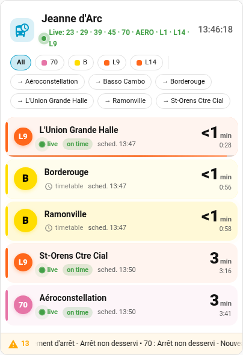
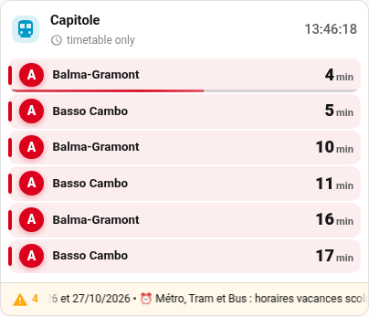
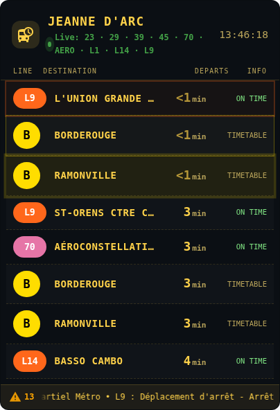
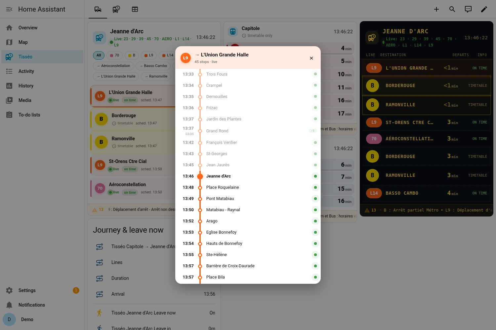
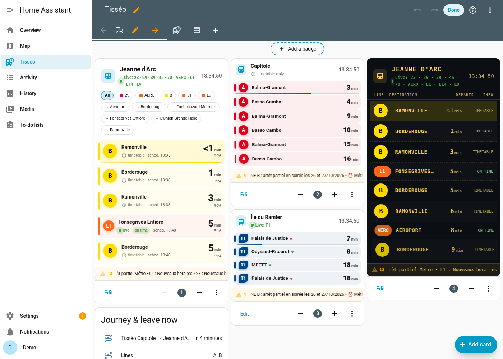

# Tisséo (Toulouse) pour Home Assistant

[English](README.md) · [Checklist HACS](docs/HACS_CHECKLIST.md) · Licence MIT

Pour le réseau toulousain : prochains passages (temps réel quand il est publié), perturbations, itinéraires avec une correspondance, aide « partir maintenant », vélos VélôToulouse et capacité des parcs relais. Une carte de tableau de bord animée est fournie.

**Aucune clé n'est nécessaire.** Tout repose sur des données ouvertes sans clé :

| Donnée | Source | Licence |
|---|---|---|
| Horaires (GTFS) | Jeu Tisséo sur transport.data.gouv.fr / data.toulouse-metropole.fr | ODbL |
| Temps réel (GTFS-RT, passages + alertes) | `api.tisseo.fr/opendata/gtfsrt/GtfsRt.pb` | ODbL |
| Vélos | GBFS v3 VélôToulouse `api.cyclocity.fr/contracts/toulouse/gbfs/v3/` | Licence ouverte JCDecaux |
| Parcs relais | Jeu Toulouse Métropole `parkings-relais` (capacité statique) | ODbL |

**En option :** vous pouvez ajouter *votre propre* clé pour l'API officielle Tisséo v2, à demander à `opendata@tisseo.fr`. L'intégration n'embarque et n'extrait aucune clé. Voir [docs/REVERSE_ENGINEERING.md](docs/REVERSE_ENGINEERING.md).



## Installation
- **HACS :** ⋮ → *Dépôts personnalisés* → ajoutez ce dépôt avec la catégorie **Intégration**. Installez *Tisséo*, puis redémarrez.
- **Manuelle :** copiez `custom_components/tisseo` dans `<config>/custom_components/`, puis redémarrez.

Allez ensuite dans *Paramètres → Appareils et services → Ajouter une intégration → Tisséo* et choisissez un type :

| Type | Étapes |
|---|---|
| **Arrêt – recherche** | Saisissez un nom (`capitole`, `jeanne d arc`), un identifiant GTFS ou un code, puis choisissez la zone d'arrêt ou un quai. |
| **Arrêt – à proximité** | Les 10 arrêts les plus proches (≤ 5 km) du domicile HA, avec la distance et les lignes. |
| **Itinéraire** | Départ et arrivée. Trajets directs ou avec **une correspondance** (temps minimal de correspondance, 3 min par défaut). |
| **Station VélôToulouse** | Les 15 stations les plus proches, avec les vélos et places libres. Les stations fantômes sans nom du flux sont masquées. |
| **Parc relais (P+R)** | Les parcs relais Tisséo triés par distance, avec leur capacité. |

Le premier ajout télécharge le GTFS (~14 Mo) et construit un index SQLite **allégé**, qui ne garde que les courses desservant vos arrêts.

### Options d'un arrêt (*Configurer*)
Filtre de lignes · nombre de capteurs (1–10, 3 par défaut) · intervalle (≥ 30 s) · alertes réseau · GTFS-RT · **temps de marche** et **marge** (2 min par défaut) · **seuil d'événement de retard** (5 min, 0 = désactivé) · **clé API Tisséo** (facultative ; laisser vide pour la retirer).

## Entités
| Entité | État | Attributs principaux |
|---|---|---|
| `sensor.<arrêt>_departure_1..N` | heure de départ prévue | `line`, `destination`, `scheduled`, `expected`, `minutes`, `realtime`, `delay_minutes`, `trip_id`, `realtime_source` (`gtfs_rt` / `tisseo_api` / `timetable`). `upcoming` sur `_1` |
| `sensor.<arrêt>_disruptions` | nombre d'alertes | `alerts`, `headlines` |
| `sensor.<arrêt>_leave_in` | minutes avant de partir | `leave_at`, `walking_time`, `buffer`, `next_catchable` |
| `binary_sensor.<arrêt>_leave_now` | `on` quand il faut partir | idem |
| `binary_sensor.<arrêt>_timetable_change_tomorrow` | `on` si demain diffère d'au moins 10 % du même jour d'une semaine de référence, ou change de calendrier | `description`, `tomorrow_departures`, `reference_departures` |
| `sensor.<départ>_<arrivée>_next_connection` | prochain départ | `arrival`, `duration_min`, `transfers`, `lines`, `legs`, `transfer_at_risk` |
| `sensor.velotoulouse_<station>_bikes_available` / `_docks_available` | nombre | `capacity`, `mechanical`, `electric`, `last_reported` |
| `sensor.tisseo_p_r_<nom>_capacity` | places | `pmr_spaces`, `bike_spaces`, `live_availability: not_available_as_open_data` |
| Diagnostic : santé du flux, dernière mise à jour réussie, taux de succès, âge du flux temps réel | `ok` / `degraded` / `down` … | état du disjoncteur, dernière erreur |

**Partir maintenant.** Le prochain départ attrapable est le premier dont `expected ≥ maintenant + marche`. On calcule `leave_at = expected − marche − marge`. `leave_now` passe à `on` une fois `leave_at` atteint, tant que ce départ reste attrapable.

**Priorité du temps réel :** GTFS-RT > API Tisséo (si vous avez une clé) > horaires théoriques.

## Fiabilité
- **Reprises et disjoncteur.** Les reprises suivent un backoff exponentiel avec gigue. Après 3 échecs consécutifs, le disjoncteur s'ouvre pour 30 s, puis jusqu'à 10 min.
- **Repli.** Le dernier instantané temps réel est conservé 5 min, ensuite les capteurs repassent sur les horaires.
- **Clé refusée.** Si votre clé est refusée (401/403), un **problème de réparation** est créé et une **réauthentification** est proposée.
- **Diagnostics.** Ils sont téléchargeables, avec la clé **masquée**.

## Événements et blueprints
- `tisseo_disruption` : nouvelle alerte (`stop_name`, `header`, `description`, `lines`, `network_wide`…).
- `tisseo_delay` : retard ≥ seuil, une fois par course (`line`, `destination`, `delay_minutes`…).
- Blueprints dans `blueprints/automation/tisseo/` : `disruption_notify`, `delay_notify` et `leave_now_notify` (plage horaire et jours).

## Détail d'une course
- **Service :** `tisseo.get_trip`.
- **WebSocket :** `tisseo/trip_stops`. Toucher une ligne de la carte ouvre la liste des arrêts de la course.

## Carte
```yaml
type: custom:tisseo-departures-card
entity: sensor.tisseo_jeanne_d_arc_departure_1
layout: default          # default | compact | board
show_filters: true       # puces ligne / destination (choix mémorisé par carte dans ce navigateur)
filter_lines: [B, L1]
trip_dialog: true
```

| compact | tableau (board) | détail course |
|---|---|---|
|  |  |  |

L'éditeur visuel est traduit en français et en anglais : 

## Limites
- **Pas de temps réel métro.** Le GTFS-RT n'en publie pas, et d'après la documentation de l'API (21/05/2025) son temps réel ne couvre que le bus et le tram.
- **Occupation des P+R.** Elle n'est pas en open data, seulement la capacité. L'occupation en direct n'existe que sur tisseo.fr, protégé contre les robots, et n'est donc pas utilisée.
- **Connexions TLS.** Sur le réseau de test, des échecs TLS intermittents vers `api.tisseo.fr` ont été observés. Ils restent visibles via les capteurs de santé.
- Projet non affilié à Tisséo ni à JCDecaux.

Le détail des mesures d'index et le journal des versions sont dans le [README anglais](README.md).
