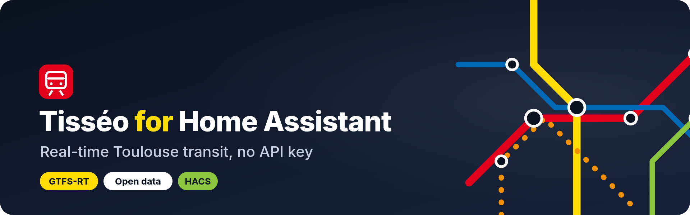
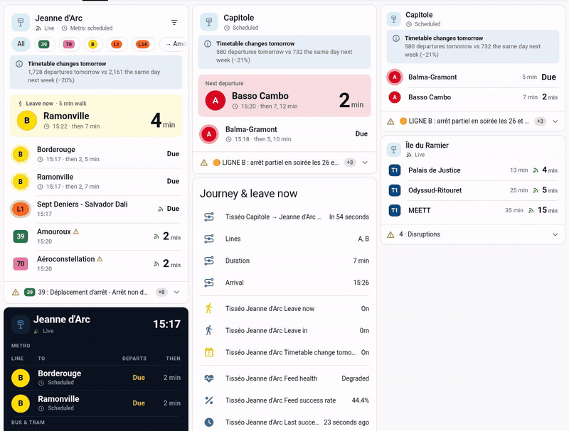
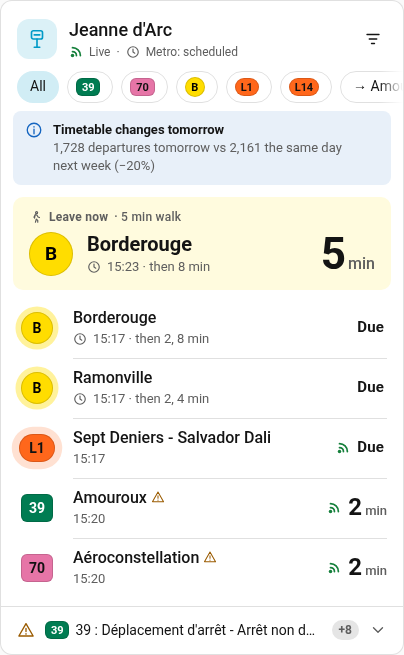
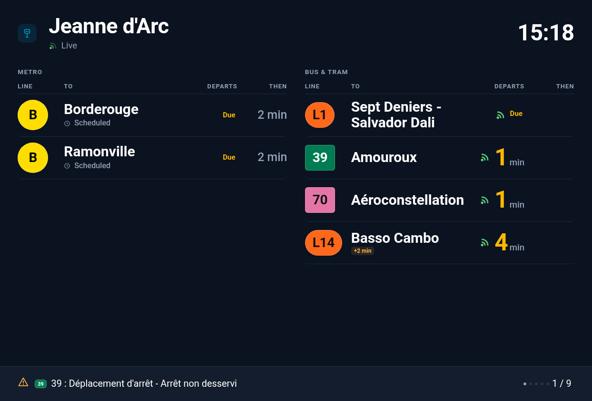
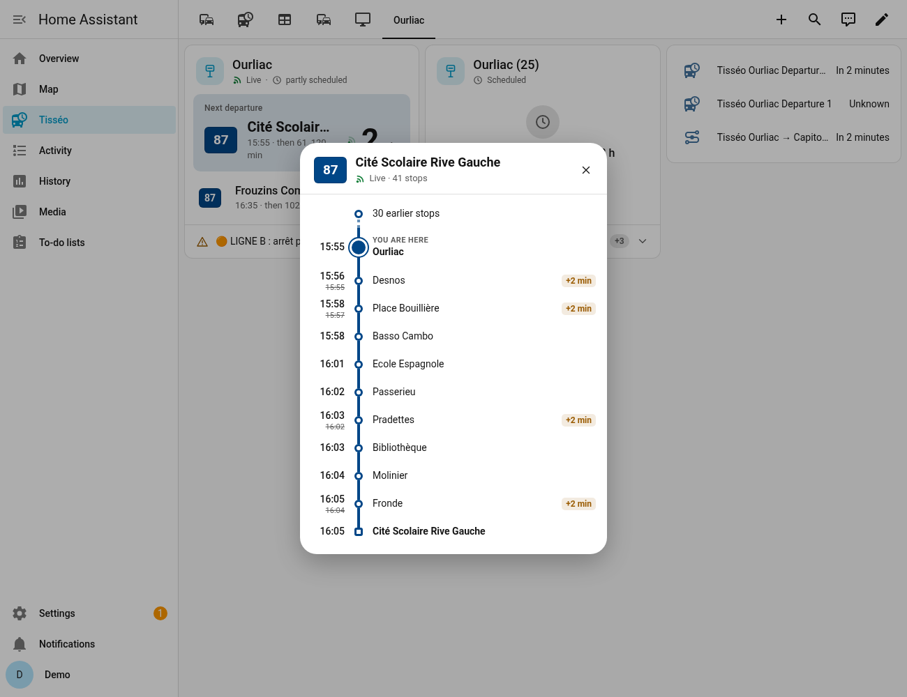
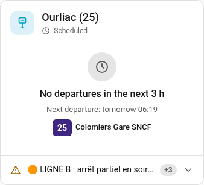
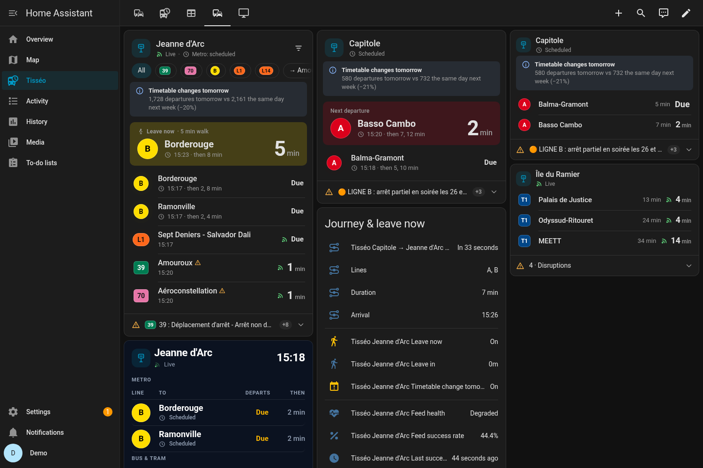
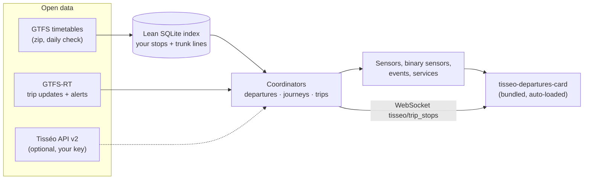
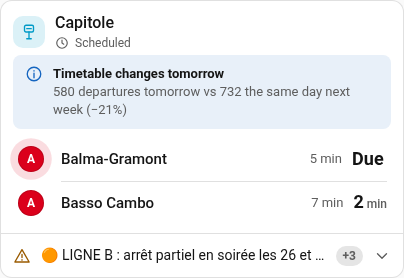
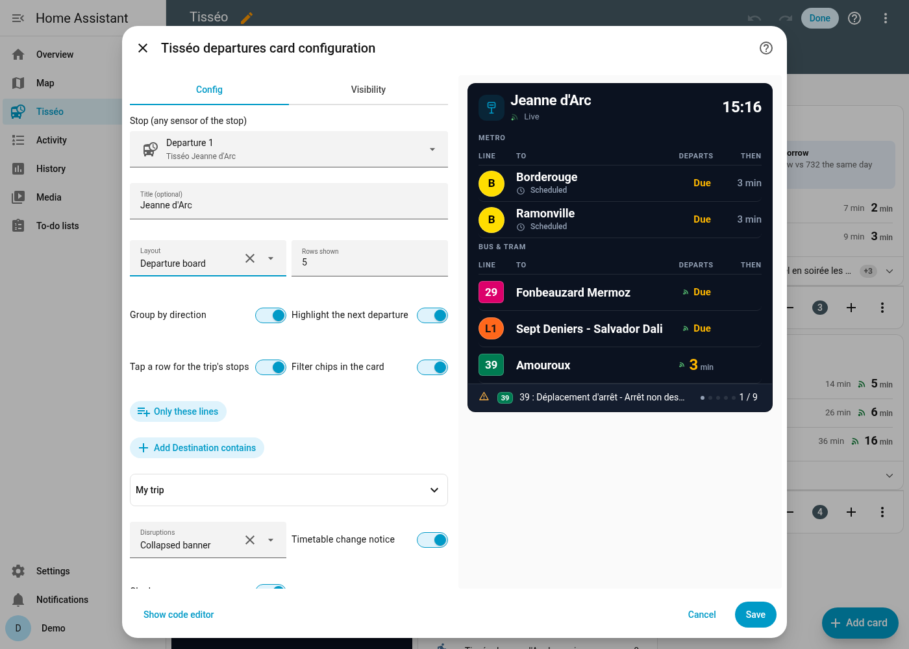

<p align="center">
  
</p>

<p align="center">
  <a href="https://hacs.xyz/docs/faq/custom_repositories/"></a>
  
  <a href="https://github.com/TurbulenceDeterministe/tisseo-ha/releases"></a>
  
  <a href="LICENSE"></a>
  <br>
  <a href="https://github.com/TurbulenceDeterministe/tisseo-ha/actions/workflows/tests.yaml"></a>
  <a href="https://github.com/TurbulenceDeterministe/tisseo-ha/actions/workflows/hassfest.yaml"></a>
  <a href="https://github.com/TurbulenceDeterministe/tisseo-ha/actions/workflows/hacs.yaml"></a>
</p>

<p align="center">
  <b>English</b> · <a href="README.fr.md">Français</a> · <a href="https://turbulencedeterministe.github.io/tisseo-ha/">Project page</a> · <a href="CHANGELOG.md">Changelog</a>
</p>

**Tisséo for Home Assistant** brings the Toulouse public transport network (metro, tram, Linéo, bus, Téléo) into Home Assistant. You get next departures with real time when Tisséo publishes it, disruptions, journeys with up to two transfers, a "leave now" helper, VélôToulouse bikes and park-and-ride capacity. An animated dashboard card is bundled and loads by itself.

**No API key and no account needed.** Everything runs on public open data (GTFS, GTFS-RT, GBFS). You can add your *own* key for the official Tisséo API if you have one, but the integration does not need it.

<p align="center">
  
</p>

## Features

| | |
|---|---|
|  | **Live departures.** Countdowns tick every second. A live icon appears only for real-time data, and delay chips only from 90 s. Departures are grouped by direction with "then" times, and a big "next departure" block shows when to leave. |
|  | **Departure board.** A dark station-style board with separate metro and bus/tram panels and paged disruptions. A compact layout is also available. |
|  | **Trip details.** Tap a departure to see every stop of the trip with its scheduled and live times. This also works for extra trips that exist only in the live feed. |
|  | **Never a blank card.** When nothing leaves in the next 3 h (some lines don't run on Sundays or in the evening), the card says when the next one does. |
|  | **Fits Home Assistant.** It follows your theme, dark mode and 12/24 h setting. Badge shapes differ by mode and colours meet AA contrast. It has a visual editor and works in English and French. |

**And also:**
- **Journeys** between two stops, direct or with one or two transfers (for example bus 25 → metro A → metro B), with "transfer at risk" warnings.
- **Leave now / leave in**, based on your walking time and a buffer.
- **Disruptions**, with `tisseo_disruption` and `tisseo_delay` events and 3 ready-made blueprints for notifications.
- A **"timetable changes tomorrow"** warning (holidays, works).
- **VélôToulouse** bikes and docks, and **P+R** capacity.
- **Health sensors**, retries with a circuit breaker, and diagnostics (with any key redacted).

## How it works



1. The **GTFS** timetable (about 14 MB) is downloaded once and checked daily. It is indexed into a lean SQLite file that keeps only the trips serving your stops, plus the metro, tram, Linéo and Téléo trips once you configure a journey.
2. The **GTFS-RT** feed is polled (every 60 s by default) and merged on top. Live times win over the timetable. Cancelled trips and skipped stops are removed, and trips added by the feed are included.
3. **Coordinators** compute departures, journeys and trip details, then publish them as entities. The card reads only those entities, plus one WebSocket command for the trip dialog.

## Install

**HACS (recommended)**

[](https://my.home-assistant.io/redirect/hacs_repository/?owner=TurbulenceDeterministe&repository=tisseo-ha&category=integration)

Or, in HACS: ⋮ → *Custom repositories* → `https://github.com/TurbulenceDeterministe/tisseo-ha`, category **Integration**. Install **Tisséo**, then restart Home Assistant.

**Manual**

Copy `custom_components/tisseo` into `<config>/custom_components/` and restart.

**Then add it**

[](https://my.home-assistant.io/redirect/config_flow_start/?domain=tisseo)

Or go to *Settings → Devices & services → Add integration → Tisséo*.

## Configuration

Each entry is one stop, journey, bike station or P+R. Add as many as you like.

| Entry type | What you do |
|---|---|
| **Stop – search** | Type a name (`capitole`, `jeanne d arc`), a GTFS id (`stop_area:SA_1715`) or a stop code. Pick the whole stop area or a single platform, and optionally some lines. |
| **Stop – nearby** | Pick from the 10 nearest stops (within 5 km) of your Home Assistant home location. |
| **Journey** | Pick an origin and a destination stop. You get direct trips and trips with one or two transfers (minimum transfer time 3 min by default). If nothing leaves within 3 h, the first connections of the next service are shown, with `later: true`. |
| **VélôToulouse station** | Pick from the 15 nearest stations, with live bikes and docks. |
| **Park-and-ride (P+R)** | Tisséo car parks by distance, with their capacity. |

**Stop options** (*Configure*): line filter · number of departure sensors (1–10, default 3) · poll interval (≥ 30 s, default 60) · network-wide alerts · use GTFS-RT · **walking time** and **buffer** (default 2 min) for leave-now · **delay event threshold** (default 5 min, 0 = off) · **Tisséo API key** (optional).

<details>
<summary><b>Entities</b></summary>

| Entity | State | Main attributes |
|---|---|---|
| `sensor.<stop>_departure_1..N` | expected departure (timestamp) | `line`, `destination`, `scheduled`, `expected`, `minutes`, `realtime`, `delay_minutes`, `trip_id`, `realtime_source` (`gtfs_rt` / `tisseo_api` / `timetable`), `live_coverage`, `line_alerts`. On `_1` only: `upcoming`, and `next_service` when nothing leaves within 3 h |
| `sensor.<stop>_disruptions` | number of active alerts | `alerts`, `headlines` |
| `sensor.<stop>_leave_in` | minutes until you must leave | `leave_at`, `walking_time`, `buffer`, `next_catchable` |
| `binary_sensor.<stop>_leave_now` | `on` when it is time to leave | same as above |
| `binary_sensor.<stop>_timetable_change_tomorrow` | `on` if tomorrow differs by ≥ 10 % from a reference day, or uses a different calendar | `description`, `tomorrow_departures`, `reference_departures`, `reference_day` |
| `sensor.<origin>_<dest>_next_connection` | next departure (timestamp) | `arrival`, `duration_min`, `transfers`, `lines`, `legs`, `transfer_at_risk`, `connections`, `later` |
| `sensor.velotoulouse_<station>_bikes_available` / `_docks_available` | count | `capacity`, `mechanical`, `electric`, `renting`, `returning`, `last_reported` |
| `sensor.tisseo_p_r_<name>_capacity` | total spaces | `pmr_spaces`, `bike_spaces`, `ev_spaces` |
| Diagnostics: `_feed_health`, `_last_successful_update`, `_feed_success_rate`, `_real_time_feed_age` | `ok` / `degraded` / `down`, … | per-feed rate, breaker state, last error |

**Leave-now rule:** the next catchable departure is the first one with `expected ≥ now + walking_time`. `leave_at = expected − walking_time − buffer`, and `leave_now` turns `on` once `leave_at` has passed.

**Real-time precedence:** GTFS-RT > Tisséo API (only with your key) > timetable.
</details>

<details>
<summary><b>Events, blueprints and services</b></summary>

| Event | When | Data |
|---|---|---|
| `tisseo_disruption` | a new alert for a configured stop (not at startup) | `stop_name`, `alert_id`, `header`, `description`, `url`, `cause`, `effect`, `network_wide`, `lines` |
| `tisseo_delay` | a departure's delay reaches the threshold (once per trip) | `stop_name`, `line`, `destination`, `trip_id`, `scheduled`, `expected`, `delay_minutes` |

Blueprints in [`blueprints/automation/tisseo/`](blueprints/automation/tisseo/): **disruption_notify**, **delay_notify** and **leave_now_notify** (with a time window and weekdays).

Trip details: the `tisseo.get_trip` service (`trip_id`, optional `stop_id`, `scheduled`) and the `tisseo/trip_stops` WebSocket command.
</details>

## Dashboard card

The card is registered automatically, so you don't add any resource. In the card picker, choose **Tisséo departures**, or use YAML:

```yaml
type: custom:tisseo-departures-card
entity: sensor.tisseo_jeanne_d_arc_departure_1   # any sensor of the stop
layout: default
```

| Option | Default | Description |
|---|---|---|
| `entity` | — | Any sensor of a Tisséo stop (required). |
| `title` | stop name | Card title. |
| `layout` | `default` | `default`, `compact` or `board`. |
| `max_departures` | `6` | Rows shown (directions, when grouped). The 1.0 option `max` also works. |
| `group` | `true` | One row per line + direction, with the following departures as "then". |
| `hero` | `auto` | Big "next departure" block (`auto` = default layout only), `true` or `false`. |
| `hero_line` | — | Pin the hero to one direction, e.g. `"B\|Borderouge"`. |
| `hero_min_minutes` | `2` | Skip departures leaving sooner than this in the hero. |
| `leave_entity` | auto | The stop's "leave in" sensor, used for "Leave in 4 min · 5 min walk". |
| `alerts` | `banner` | `banner`, `count` or `off`. |
| `timetable_notice` | `true` | Notice when tomorrow's timetable differs. |
| `show_filters` | `false` | Line / direction chips (the choice is saved per card in this browser). |
| `filter_lines` / `filter_destinations` | — | Fixed filters, e.g. `[B, L1]` / `[Ramonville]`. |
| `trip_dialog` | `true` | Tap a row to open the trip's stops. |
| `show_clock` | `false` | Clock in the header. |
| `badge_contrast` | `auto` | `auto` (AA-contrast text on line colours) or `brand` (GTFS colours as they are). |
| `board_theme` | `dark` | `dark` or `auto` (follow Home Assistant). |

| default | compact | board | visual editor |
|---|---|---|---|
|  |  |  |  |

## FAQ

**Why is there no live time for the metro?**
Tisséo's public real-time feed (GTFS-RT) has no metro trip updates. The official API documentation (21/05/2025) says its real time covers only bus and tram, so a key would not change this. Metro times come from the timetable, and the card labels them "scheduled". Metro disruptions do come through as alerts.

**Why is no API key needed?**
Tisséo publishes its timetables (GTFS) and real time (GTFS-RT) as open data under ODbL. VélôToulouse publishes GBFS. None of these feeds needs a key. If Tisséo gave you a personal key for the API v2, you can add it in the stop options as an extra source. The integration does not ship, extract or reuse any key from the official app; see [docs/REVERSE_ENGINEERING.md](docs/REVERSE_ENGINEERING.md).

**A stop shows "No departures in the next 3 h".**
Some lines don't run in the evening or on Sundays. The card then shows the next scheduled departure, which is also available as the `next_service` attribute.

**How big is the index?**
From about 7 MB (one quiet stop) to about 26 MB (several busy hubs). Once a journey is configured it is about 32–35 MB, because the trunk lines are added. It rebuilds by itself when you add stops or upgrade. Measurements are in [CHANGELOG.md](CHANGELOG.md#index-size).

**Can it show live P+R occupancy?**
No. Only the capacity is open data. The live figures exist only on tisseo.fr, which is bot-protected, so they are not used.

**Live data sometimes drops out.**
Connections to `api.tisseo.fr` can fail now and then. The integration retries, keeps the last real-time data for 5 minutes, then falls back to the timetable. The health sensors show when this happens.

## Limitations
- Journeys allow at most two transfers. The middle leg must be a metro, tram, Linéo or Téléo line, and transfers only happen within the same stop area (no walking between different stops).
- There is no live metro and no live P+R occupancy (see the FAQ).
- Some VélôToulouse stations report old `last_reported` timestamps.

## Development
```bash
pip install -r requirements_test.txt
pytest tests                                   # unit + Home Assistant tests (offline, synthetic feeds)
TISSEO_LIVE=1 pytest tests/test_live_ha.py -s  # against the live open-data feeds
```
See [CONTRIBUTING.md](CONTRIBUTING.md).

## Credits and data licence
- Timetables and real-time data © **Tisséo**, under the [Open Database License (ODbL)](https://opendatacommons.org/licenses/odbl/1-0/), via [transport.data.gouv.fr](https://transport.data.gouv.fr/) and [data.toulouse-metropole.fr](https://data.toulouse-metropole.fr/).
- VélôToulouse data © JCDecaux (GBFS, JCDecaux open licence). P+R data © Toulouse Métropole (ODbL).
- Code under the [MIT licence](LICENSE).

## Disclaimer
This is an **unofficial** community project. It is **not affiliated with, endorsed by or supported by Tisséo**, Tisséo Collectivités, Toulouse Métropole or JCDecaux. "Tisséo" and the line names and colours belong to their owners. For official information, use [tisseo.fr](https://www.tisseo.fr/). Departure times can be wrong; don't rely on them for anything critical.
