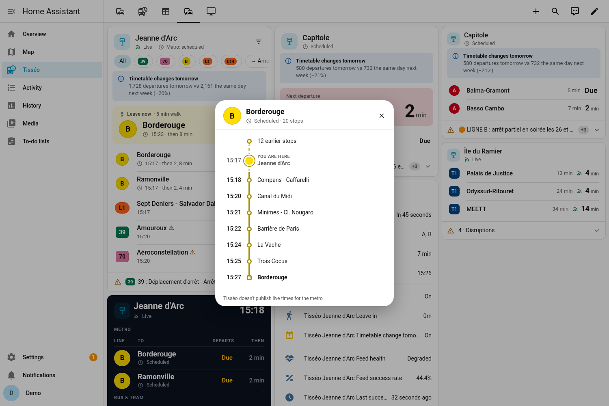

# Tisséo (Toulouse) for Home Assistant

[Français](README.fr.md) · [HACS checklist](docs/HACS_CHECKLIST.md) · MIT licence

Next departures with real-time data when it is published, plus disruptions, journeys with one transfer, a "leave now" helper, VélôToulouse bikes and park-and-ride capacity for the Toulouse network. It comes with an animated dashboard card.

**No key is needed.** Everything runs on keyless open data:

| Data | Source | Licence |
|---|---|---|
| Timetables (GTFS) | Tisséo dataset on transport.data.gouv.fr / data.toulouse-metropole.fr | ODbL |
| Real time (GTFS-RT trip updates + alerts) | `api.tisseo.fr/opendata/gtfsrt/GtfsRt.pb` | ODbL |
| Bikes | VélôToulouse GBFS v3 `api.cyclocity.fr/contracts/toulouse/gbfs/v3/` | JCDecaux Open Licence |
| Park-and-ride | Toulouse Métropole dataset `parkings-relais` (static capacity) | ODbL |

**Optional:** you can add *your own* key for the official Tisséo API v2. Request it from `opendata@tisseo.fr`. The integration never embeds or extracts any key. See [docs/REVERSE_ENGINEERING.md](docs/REVERSE_ENGINEERING.md) for what the official app uses and why none of it is reused.


## Install
- **HACS:** ⋮ → *Custom repositories* → add this repository with category **Integration**. Install *Tisséo*, then restart.
- **Manual:** copy `custom_components/tisseo` to `<config>/custom_components/`, then restart.

Then go to *Settings → Devices & services → Add integration → Tisséo* and pick an entry type:

| Entry type | Steps |
|---|---|
| **Stop – search** | Type a name (`capitole`, `jeanne d arc`), a GTFS id (`stop_area:SA_1715`) or a code. Then pick the stop area or one platform, and set the options. |
| **Stop – nearby** | Lists the 10 nearest stops (≤ 5 km) around the HA home location, with their distances and lines. |
| **Journey** | Origin and destination stops. Direct trips plus trips with **one transfer** (minimum transfer time, default 3 min). |
| **VélôToulouse station** | The 15 nearest stations with live bikes and docks. Unnamed placeholder stations in the feed are hidden. |
| **Park-and-ride (P+R)** | Tisséo P+R car parks sorted by distance, with their capacity. |

The first stop setup downloads the GTFS (~14 MB) and builds a **lean** SQLite index that only holds the trips serving your configured stops.

### Stop options (*Configure*)
Lines filter · number of departure sensors (1–10, default 3) · poll interval (≥ 30 s, default 60) · network-wide alerts · use GTFS-RT · **walking time** (min) and **buffer** (default 2 min) for leave-now · **delay event threshold** (default 5 min, 0 = off) · **Tisséo API key** (optional; leave empty to remove it).

## Entities
| Entity | State | Main attributes |
|---|---|---|
| `sensor.<stop>_departure_1..N` | expected departure (timestamp) | `line`, `destination`, `scheduled`, `expected`, `minutes`, `realtime`, `delay_minutes`, `trip_id`, `realtime_source` (`gtfs_rt` / `tisseo_api` / `timetable`), `live_coverage`, `line_alerts`. On `_1` only: `upcoming` |
| `sensor.<stop>_disruptions` | number of active alerts | `alerts`, `headlines` |
| `sensor.<stop>_leave_in` | minutes until you must leave | `leave_at`, `walking_time`, `buffer`, `next_catchable` |
| `binary_sensor.<stop>_leave_now` | `on` when it is time to leave | same as above |
| `binary_sensor.<stop>_timetable_change_tomorrow` | `on` if tomorrow differs by ≥ 10 % from the same weekday of a reference week, or uses a different service calendar | `description`, `tomorrow_departures`, `reference_departures`, `reference_day` |
| `sensor.<origin>_<dest>_next_connection` | next departure (timestamp) | `arrival`, `duration_min`, `transfers`, `lines`, `legs`, `transfer_at_risk`, `connections` |
| `sensor.velotoulouse_<station>_bikes_available` / `_docks_available` | count | `capacity`, `mechanical`, `electric`, `renting`, `returning`, `last_reported` |
| `sensor.tisseo_p_r_<name>_capacity` | total spaces | `pmr_spaces`, `bike_spaces`, `ev_spaces`, `live_availability: not_available_as_open_data` |
| Diagnostic: `_feed_health`, `_last_successful_update`, `_feed_success_rate`, `_real_time_feed_age` | `ok` / `degraded` / `down`, … | per-feed rate, breaker state, last error |

**Leave-now rule.** The next catchable departure is the first one with `expected ≥ now + walking_time`. Then `leave_at = expected − walking_time − buffer` and `leave_in = max(0, leave_at − now)` in minutes. `leave_now` is `on` once `leave_at` has passed, as long as that departure is still catchable.

**Real-time precedence:** GTFS-RT > Tisséo API (only if you set a key) > timetable. Canceled trips and skipped stops are removed. ADDED trips are added. An API prediction is matched to the scheduled trip of the same line within ±15 min.

## Reliability
- **Retries and circuit breaker.** Each feed has a 50-sample success window. Retries use jittered exponential backoff, with 4 attempts across two GTFS-RT URLs. After 3 consecutive failures the circuit breaker opens for 30 s, doubling up to 10 min.
- **Fallbacks.** When real time fails, the last RT snapshot is kept for 5 min, then the sensors fall back to the timetable.
- **API key errors.** If the API rejects your key (401/403), a **repair issue** is raised and a **re-authentication** flow starts. Departures keep working without the key in the meantime.
- **Diagnostics.** *Download diagnostics* shows the feed health, index stats and options, with the API key **redacted**.

## Events and blueprints
| Event | When | Data |
|---|---|---|
| `tisseo_disruption` | a new alert appears for a configured stop (not at startup) | `entry_id`, `stop_id`, `stop_name`, `alert_id`, `header`, `description`, `url`, `cause`, `effect`, `network_wide`, `lines` |
| `tisseo_delay` | a departure's delay reaches the threshold (once per trip) | `stop_name`, `line`, `destination`, `trip_id`, `scheduled`, `expected`, `delay_minutes`, `realtime_source` |

Blueprints are in `blueprints/automation/tisseo/`: **disruption_notify**, **delay_notify** and **leave_now_notify**. The last one has a time window and weekdays. Copy them to `<config>/blueprints/automation/tisseo/` or import them from the repository URL.

## Trip details
- **Service:** `tisseo.get_trip` (`trip_id`, optional `stop_id` and `scheduled`) returns every stop of the trip with its scheduled and expected times.
- **WebSocket:** `tisseo/trip_stops` does the same. The card uses it to open the trip dialog.

## Dashboard card
The card is loaded automatically, so there is no resource to add. It has a visual editor in the card picker under "Tisséo departures". It is one self-contained file (no build step, no external fonts or scripts) and follows the Home Assistant theme, including dark mode.

```yaml
type: custom:tisseo-departures-card
entity: sensor.tisseo_jeanne_d_arc_departure_1   # any sensor of the stop
layout: default          # default | compact | board
max_departures: 6        # rows (directions when grouped); `max` from 1.0 still works
group: true              # one row per line + direction, the next ones shown as "then"
hero: auto               # big "next departure" block (auto = default layout only)
hero_line: "B|Borderouge"  # optional: pin the hero to one direction
alerts: banner           # banner | count | off  (`show_alerts: false` from 1.0 still works)
timetable_notice: true   # notice when tomorrow's timetable differs
show_filters: true       # line / direction chips; the selection is saved per card in this browser
filter_lines: [B, L1]    # fixed filters (optional)
filter_destinations: [Ramonville]
trip_dialog: true        # tap a row to see the trip's stops
show_clock: false
badge_contrast: auto     # auto (WCAG AA text on line colours) | brand (GTFS colours as-is)
board_theme: dark        # dark | auto (follow Home Assistant)
```

What the card shows, and where it comes from:
- **Countdowns** from `expected` of each departure in `upcoming`, ticking every second (paused when the card is off screen or the tab is hidden). The live icon is shown only when `realtime` is true; scheduled times get a clock icon.
- **Delay chips** (`+3 min` / `−2 min`) from the per-departure delay, only from 90 s (GTFS-RT jitter is hidden). Canceled trips are struck through.
- **Leave now:** when the stop has a walking time, the hero uses the integration's "leave in" sensor (walking time + buffer) and says "Leave in 4 min · 5 min walk" or "Leave now".
- **Disruptions** from the stop's disruptions sensor. Tisséo publishes no severity, so it is derived from the GTFS-RT effect (no service → severe; detour, moved stop, reduced service → warning; else info). Line-specific alerts also flag the matching rows.
- **Notices:** live data unavailable (feed health `down`, or `live_coverage: feed_unavailable`), stale data, and the "timetable change tomorrow" binary sensor.
- **Board:** a dark departure board; metro and bus/tram split into two panels on wide screens; disruptions page one at a time every 8 s.
- **Accessibility:** badge shapes differ by mode (metro circle, tram rounded square, Linéo pill, bus rectangle), every row has a spoken label, and reduced motion, high contrast and forced colours are respected.

| default | compact | board |
|---|---|---|
|  |  |  |

| dark theme | trip dialog | visual editor |
|---|---|---|
|  |  |  |

## Index size (measured on the 2026-10 GTFS, x86 box)
| Index | Build | Size |
|---|---|---|
| 0.3.0 (all stop_times, without trips) | 5.1 s | 26.1 MB |
| 1.0.0 full (all trips, needed for journeys and trip details) | 6.0 s | 47.0 MB |
| 1.0.0 **lean**, 3 stops (25,063 trips) | 4.5 s | 25.7 MB |
| 1.0.0 lean, Capitole only | 3.9 s | 10.6 MB |
| 1.0.0 lean, Île du Ramier only | 3.9 s | 7.0 MB |

Adding a stop that is not covered yet rebuilds the index automatically.

## Limitations
- **No live metro.** The keyless GTFS-RT has no metro trip updates. The official API documentation (21/05/2025) says its real time only covers bus and tram, so a key does not change this. Metro times come from the timetable, and metro status comes from the alerts.
- **P+R occupancy is not open data.** Only the static capacity is published. Live occupancy is only on tisseo.fr, which is bot-protected, so it is not used.
- **TLS failures to `api.tisseo.fr`.** On the test network the TLS handshake failed intermittently. The breaker, the backoff and the health sensors make this visible rather than hiding it.
- **Bike timestamps.** `last_reported` comes from the GBFS feed, and some stations report old timestamps.
- Not affiliated with Tisséo or JCDecaux.

## Development
```bash
pip install -r requirements_test.txt
pytest tests                                   # unit + HA tests
TISSEO_LIVE=1 pytest tests/test_live_ha.py -s  # against live feeds
python scripts/set_github_user.py <user>       # set the GitHub owner (placeholder)
```

## Changelog
### 1.1.0
- **New card design** (v2), integrated into the bundled card as one file: a "next departure" hero with leave-now, departures grouped by direction with "then" times, delay chips with a 90 s threshold, mode-specific badge shapes with automatic AA contrast, a collapsed disruptions banner, notices for missing live data and tomorrow's timetable change, a dark departure board with metro / bus & tram panels and a paged disruptions footer, and a native `<dialog>` trip timeline.
- New card options: `max_departures`, `group`, `hero`, `hero_line`, `leave_entity`, `alerts`, `timetable_notice`, `show_clock`, `badge_contrast`, `board_theme`. The 1.0 options keep working (`max`, `show_alerts`, filters, `trip_dialog`).
- One shared ticker per card (second-aligned, paused off screen), keyed row updates, and a regroup every 30 s so departed trips drop out between sensor updates.
- The card follows Home Assistant's 12 h / 24 h time setting.

### 1.0.0
- New entry types: **nearby stops**, **journeys with one transfer**, **VélôToulouse stations** and **P+R**.
- New stop entities: **leave now / leave in** and **timetable change tomorrow**.
- New `tisseo_disruption` / `tisseo_delay` events, with 3 blueprints.
- **Optional user API key** (Tisséo API v2 `stops_schedules`), with validation, a repair issue and reauth.
- **Reliability:** backoff, circuit breaker, health sensors, and diagnostics with the key redacted.
- **Lean index** (schema v4) that also stores full trips.
- `tisseo.get_trip` service and `tisseo/trip_stops` WebSocket command.
- **Card:** compact and board layouts, filter chips, trip dialog, and a schema-based visual editor (en/fr).
- **Packaging:** HACS metadata, brand icon, CI workflows (hassfest, HACS, pytest), issue templates, and a French README.

### 0.3.0
- Animated card. 0.2.0 added real-time attribution and 0.1.x the first release (see git history).
